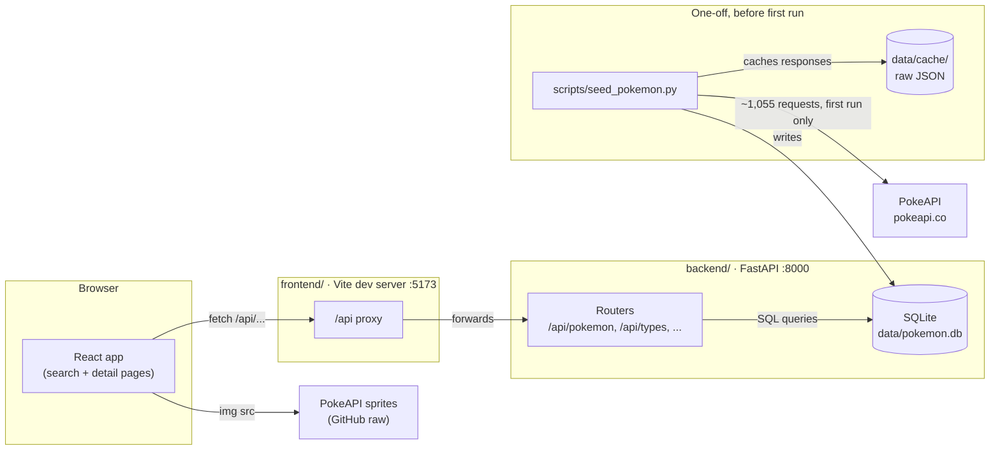
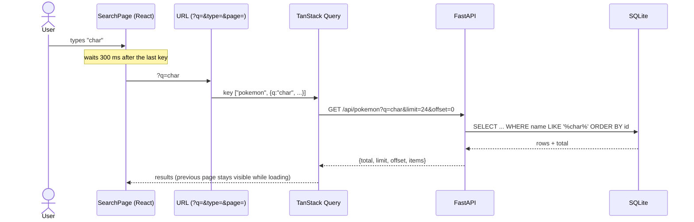

# Pokémon Search: FastAPI + React

A full-stack app to search every Pokémon from Generation I to IX (1,025 species) by name or number, filter by generation and type, and open a detail page for each.

**Working now:** search, filters, pagination, and detail pages with each Pokémon's Scarlet/Violet moves, on a FastAPI + SQLite backend and a React + TypeScript frontend, with CI on every pull request.

**Next:** sign-in (guest or username/password), nicknames, and comments on favourite Pokémon. See [Roadmap](#roadmap).

| Layer | Stack |
|---|---|
| Backend | Python 3.12, FastAPI, SQLModel (SQLAlchemy + Pydantic), SQLite, uv |
| Frontend | React 19, TypeScript 7 (strict), MUI 9, React Router, TanStack Query, Vite |
| Quality | pytest, Vitest + Testing Library, Ruff, oxlint |
| Delivery | GitHub Actions (tests, lint, type-check, build, security audits), Dependabot |

---

## Architecture



**The key idea:** PokeAPI is used **once, offline**, not on every request. A seed script downloads all species with about 30 requests (one per generation, one per type), then each Pokémon's moves with one request per Pokémon (about 1,025, 4 at a time, about 45 seconds the first time). It caches the responses and writes them to SQLite. From then on the API answers every search from the local database, so it's fast, works offline, and puts no load on PokeAPI.

### How a search flows



---

## Design decisions

| Decision | Why | Trade-off |
|---|---|---|
| **Seed once from PokeAPI into SQLite** instead of calling PokeAPI per request | Fast and reliable searches; follows PokeAPI's fair-use rule ("Locally cache resources whenever you request them") | Data is a snapshot; re-run the seed (`--refresh`) to pick up new Pokémon |
| **About 30 seed requests for names and types** | The generation and type endpoints together give every species' name, generation and types | Moves have no bulk endpoint, so they need one request per Pokémon (about 1,025). That's done once, 4 at a time, and cached |
| **Moves cached trimmed** | A full `/pokemon/{id}` response can be about 700 kB; keeping only move names, methods, levels and games cuts the cache to about 69 MB. Every game is kept, so changing the game filter needs no re-download | `--refresh` re-downloads everything |
| **Scarlet/Violet moves only** (including its DLC) | One clear, complete game. PokeAPI's list of games isn't in date order, and the newest games' move data is still partial | 292 Pokémon aren't in Scarlet/Violet (e.g. Zygarde), so they show "no moves listed" rather than moves from an older game |
| **Moves are a separate endpoint and request** | The main details show at once; Mew alone has 241 move rows | Two requests per detail page |
| **Seed refuses to save incomplete data** | A Pokémon with no type, a duplicate number or two types in one slot fails the run instead of quietly producing bad data | A broken upstream response stops the seed until it's looked at |
| **SQLite** | No server to run; one file; plenty for a read-heavy app of this size | Not for many concurrent writers. Going through SQLModel/SQLAlchemy keeps a later move to PostgreSQL small: the connection settings in `db.py` plus migrations |
| **Types in their own table** (`pokemon_type`, one row per slot) | Filtering by type is a normal indexed SQL query, and slot order (primary/secondary) is kept | One extra join when reading a Pokémon |
| **Vite proxy for `/api`** instead of CORS | The browser sees one origin, so there's no CORS configuration to get wrong | Needs the same pattern (or a reverse proxy) when deployed |
| **Search state in the URL** (`?q=&generation=&type=&page=`) | Searches can be bookmarked and shared, and the Back button returns to the same results | URL values need checking: a non-numeric page or generation is ignored; an unknown type just returns no results |
| **300 ms typing delay** (a small `useDebouncedValue` hook) | One API call when the user pauses, not one per keystroke | Results appear slightly after typing stops |
| **TanStack Query** for server data | Caching, cancelling stale requests, and keeping the previous page visible while the next loads | One more library |
| **Strict TypeScript, checked in CI** | Catches mistakes the tests don't (e.g. MUI 9's removed props failed the build, not the tests) | Slightly more typing |
| **Search input is validated and escaped** | `limit` 1–100, `offset` ≥ 0, `q` ≤ 50 characters; `%` and `_` typed by a user are matched literally, not as SQL wildcards | — |

---

## Project structure

```
backend/
  app/
    app.py            FastAPI app, startup (creates tables), health route
    db.py             SQLite engine and per-request session
    models.py         Tables (pokemon, pokemon_type) and response models
    routers/pokemon.py  /api/pokemon, /api/pokemon/{id}, /api/types, /api/generations
  scripts/seed_pokemon.py  One-off PokeAPI → SQLite loader (cached, validated)
  tests/              pytest: API tests on an in-memory database, seed logic tests
  main.py             Runs the server (uvicorn, 127.0.0.1:8000)
frontend/
  src/
    api/              Typed API client and response types
    pages/            SearchPage, PokemonDetailPage, NotFoundPage
    components/       PokemonCard, TypeChip
    lib/              Formatting, URL search-param helpers, useDebouncedValue
    test/             Test setup and a fake backend for page tests
  vite.config.ts      Dev server, /api proxy, test settings
.github/
  workflows/          CI, Lint, Frontend, Security audit
  dependabot.yml      Weekly dependency update PRs
```

---

## Getting started

Requirements: Python 3.12 with [uv](https://docs.astral.sh/uv/), Node 24 with npm.

**Backend** (terminal 1):

```bash
cd backend
uv run python -m scripts.seed_pokemon   # first time: loads all Pokémon and moves (~1,055 requests, ~45 s, cached)
uv run main.py                          # http://127.0.0.1:8000/docs
```

**Frontend** (terminal 2, backend running):

```bash
cd frontend
npm install       # first time
npm run dev       # http://localhost:5173
```

On macOS with the python.org installer, run `Install Certificates.command` (in `/Applications/Python 3.12/`) once if the seed fails with `CERTIFICATE_VERIFY_FAILED`.

---

## API

Interactive docs at `/docs` (generated by FastAPI from the code).

| Endpoint | What it does |
|---|---|
| `GET /api/pokemon` | Search and list. `q` (name contains, or a Pokédex number), `generation`, `type`, `limit` (1–100, default 20), `offset`. Returns `{total, limit, offset, items}` |
| `GET /api/pokemon/{id}` | One Pokémon by National Pokédex number (404 if not found) |
| `GET /api/pokemon/{id}/moves` | Scarlet/Violet moves, grouped by method (level-up, TM, egg, tutor). Level-up sorted by level (0 = learned on evolution), the rest by name. Empty `groups` if the Pokémon isn't in Scarlet/Violet |
| `GET /api/types` | All types, for filters |
| `GET /api/generations` | All generations, for filters |
| `GET /api/health` | Health check |

---

## Testing

| | Command | What's covered |
|---|---|---|
| Backend | `cd backend && uv run pytest` | Every endpoint against an in-memory SQLite database (search, filters, pagination, validation, 404s, wildcard escaping), and the seed logic against hand-made PokeAPI-shaped data. No test touches the network or the real database. |
| Frontend | `cd frontend && npm test` | Pages rendered against a fake backend (results, filters from the URL, empty and error states, unknown routes), the API client, formatting, and the typing delay with a simulated clock so it doesn't depend on machine speed |

Tests were checked by breaking the code on purpose (removing the wildcard escaping, the type filter, the typing delay, and so on) and confirming that a test fails each time.

---

## CI/CD and dependencies

Every pull request and every push to `main` runs:

- **CI:** backend tests
- **Lint:** Ruff lint and format checks (backend)
- **Frontend:** `npm ci`, oxlint, tests, then strict type-check and production build
- **Security audit:** `pip-audit` on `uv.lock` and `npm audit` on `package-lock.json`, also every Monday

Dependabot opens weekly update PRs for Python packages, npm packages and GitHub Actions. Major `@types/node` updates are ignored so the types match the Node version in use (24).

Work goes through small branches and pull requests, each merged after review with all checks passing. That's the practice so far; it isn't yet enforced by GitHub branch protection.

---

## Roadmap

1. **Sign-in:** guest browsing, plus username/password accounts (hashed passwords, token in a secure cookie). Users choose a nickname.
2. **Favourites and comments:** users comment on their favourite Pokémon; only the author can edit or delete.
3. **Later:** Google and GitHub sign-in (OAuth); database migrations with Alembic once user tables exist; a production setup that serves the built frontend and API from one origin; splitting the frontend bundle (currently about 569 kB, 178 kB gzipped).

---

## How this was built

Built with AI coding agents under my design, review and release control. Every change went through a pull request with automated checks before I merged it.

## Credits

Pokémon data from [PokeAPI](https://pokeapi.co/) (cached locally per its fair-use policy). Sprites from the [PokeAPI sprites](https://github.com/PokeAPI/sprites) repository. Pokémon and Pokémon character names are trademarks of Nintendo, Creatures Inc. and GAME FREAK inc. This is a private, non-commercial learning project.
